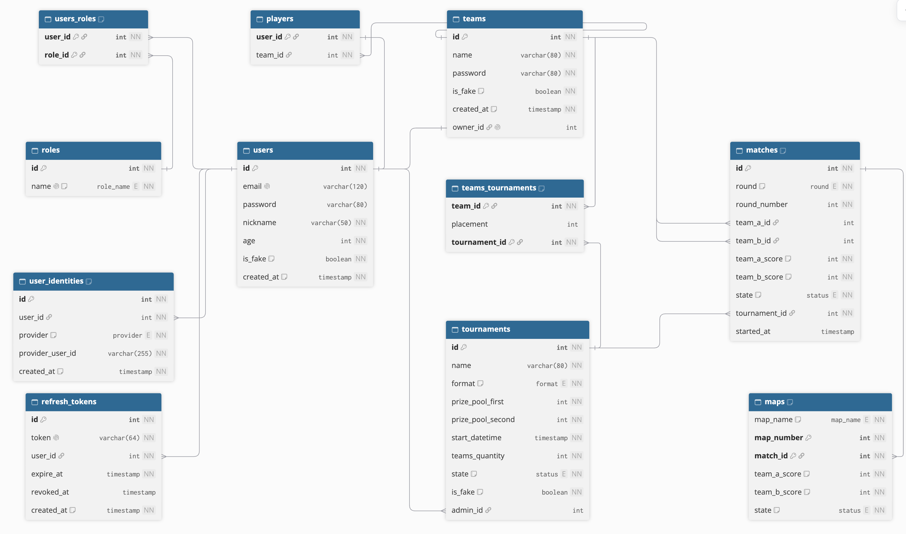

# 🏆 Next API

API de uma plataforma de campeonatos de Counter-Strike com partidas simuladas, construída com Java e Spring Boot.

> 🚧 Projeto em desenvolvimento. As regras de negócio e a modelagem do banco estão concluídas, e a implementação da API está começando.

## 🎯 Sobre o projeto

A plataforma organiza campeonatos de CS em eliminatória simples, com partidas simuladas round a round por um job agendado. Ela fica sempre em movimento: campeonatos com times pré-cadastrados rodam o tempo todo, e usuários podem criar os próprios times e campeonatos.

O que está planejado:

- Cadastro com email e senha, e login com Google (OAuth2) e Steam (OpenID).
- Autenticação com JWT e refresh token com rotação.
- Times com 5 jogadores e campeonatos com 4, 8 ou 16 times, em formato MD1 ou MD3.
- Tabela gerada automaticamente com eliminação simples.
- Simulação de partidas round a round, incluindo prorrogações.
- Times pré-cadastrados com jogadores profissionais e campeonatos internos contínuos.
- Estatísticas por time (winrate geral, recente e por mapa) e ranking.

## 🛠 Stack tecnológica

**Backend**
- Java 25
- Spring Boot 4
- Spring Security (OAuth2 Client e Resource Server)
- Spring Data JPA

**Banco de dados**
- PostgreSQL 18
- Flyway

**Testes**
- Testcontainers
- JUnit 5 e Mockito (em breve)

**Infraestrutura & DevOps**
- Docker Compose
- GitHub Actions (em breve)
- AWS (em breve)

## 🗂 Modelagem do banco



## 🚀 Como rodar localmente

### Pré-requisitos

- Java 25
- Docker

### Passos

```bash
git clone https://github.com/icarocavalari/Next-API.git
cd Next-API
cp .env.example .env
./mvnw spring-boot:run
```

Preencha as variáveis do banco no `.env` antes de rodar. Com o Docker aberto, o Spring Boot sobe o PostgreSQL automaticamente pelo `compose.yaml`.
